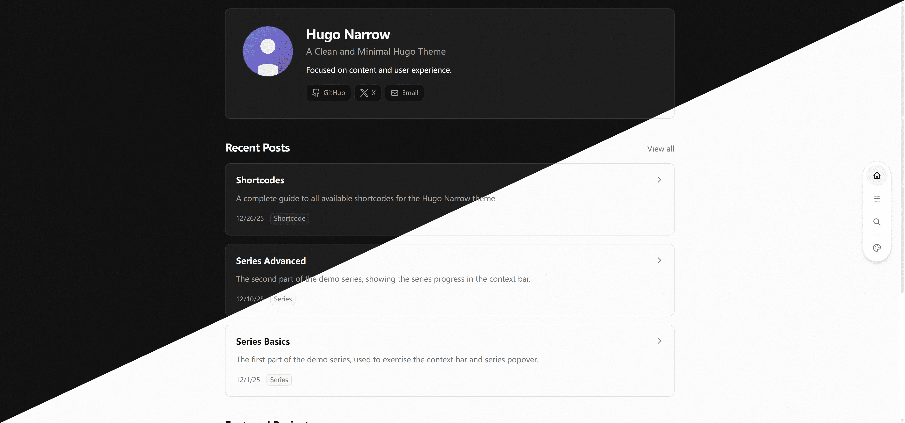

# Hugo Narrow

**[Documentation](https://tom2almighty.github.io/hugo-narrow-docs/en/)** · **[Demo](https://tom2almighty.github.io/hugo-narrow/)** · **[中文](README.zh-Hans.md)**

A reading-first Hugo theme with an adaptive dock, a breadcrumb context bar, Shadcn-style semantic tokens, and a centered content width that readers can adjust.

> [!NOTE]
> Hugo Narrow is no longer maintained; v2 was the last version line. Before AI coding tools became widespread, Hugo was a strong fit for personal sites: a single Go binary, fast builds, and shortcodes that made small extensions easy. Those tools have since made generating a personal site much simpler, and the frontend ecosystem offers mature libraries that other frameworks can import directly. Astro and similar frameworks do not treat themes as a core abstraction, but with AI every site can become its own theme. Hugo's theme ecosystem fits that workflow less well, and its template tooling still lacks a mature, widely adopted formatter, which makes maintenance costly.
>
> Maintenance is therefore ending; only the related [astro-narrow](https://github.com/tom2almighty/astro-narrow) theme will continue. Frontend themes are opinionated by nature, so a fork is often a better fit than a shared upstream; you are welcome to use AI to maintain your own. Existing v2 sites should pin their current v2 release.
>
> The v1 line is preserved on the `v1` branch.
> See the [2.0.0 release notes](https://github.com/tom2almighty/hugo-narrow/releases/tag/v2.0.0) for the full list of breaking changes and migration notes. 
> A v1 preview is available at https://tom2almighty.github.io/hugo-narrow/v1/.

## Development environment

- Hugo Extended 0.165.0 or newer
- Go 1.26 or newer (for `gotmplfmt`)
- Node.js 18 or newer
- pnpm 10

```bash
go install github.com/gohugoio/gotmplfmt@v0.5.0
pnpm install
pnpm run dev:parallel
```

`dev:parallel` runs the Tailwind watcher and the Hugo server together. Run `pnpm run compile` after changing Tailwind classes if you use plain `hugo server`.

## Build and deploy

```bash
pnpm run check   # format check + production build
pnpm run build   # compile assets/css/compiled.css, then hugo --minify
```

The example site is built into `exampleSite/public`. When packaging the theme, ship the regenerated `assets/css/compiled.css`; Hugo only fingerprints and minifies it. The theme has no Nginx or container configuration; mount it in a Hugo site or serve the static output from your own runtime.

## License

AGPL-3.0. See [LICENSE](LICENSE).
